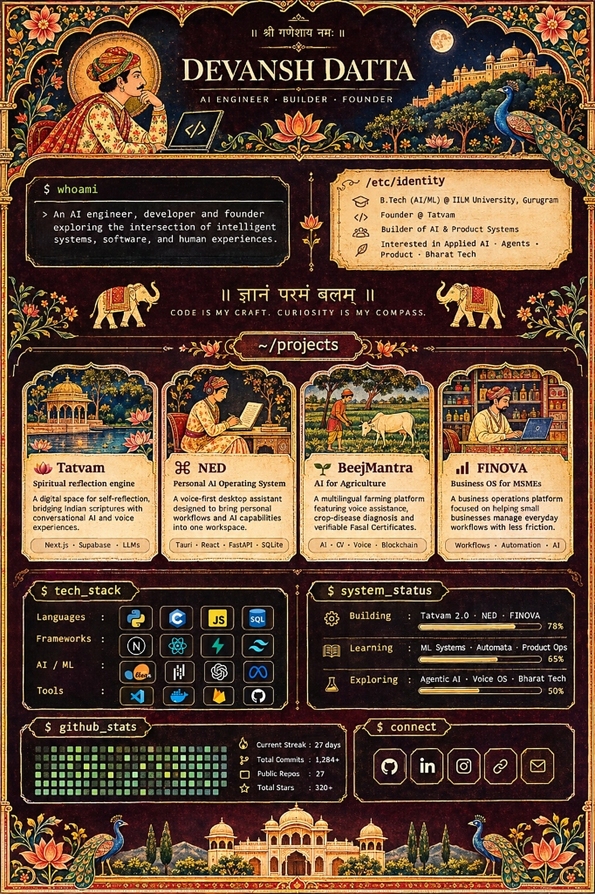

  

   
  
  &nbsp;
  
  &nbsp;
  
  &nbsp;
  
  &nbsp;
  

 

  
<b>📜 Click to expand System Identity & Terminal Specifications</b>

   

### `$ whoami`
> An AI engineer, developer and founder exploring the intersection of intelligent systems, software, and human experiences.

### `/etc/identity`
- 🎓 **Education:** B.Tech (AI/ML) @ IILM University, Gurugram
- 💻 **Founder:** [Tatvam](https://tatvambot.vercel.app/)
- 🛠️ **Role:** Builder of AI & Product Systems
- 🍃 **Focus:** Applied AI · Voice Agents · Bharat Tech

---

### `~/projects`

| Project | Tagline | Description | Stack |
| :--- | :--- | :--- | :--- |
| [**🪷 Tatvam**](https://tatvambot.vercel.app/) | Spiritual reflection engine | A digital space for self-reflection bridging Indian scriptures with conversational AI and voice experiences. | `Next.js` `Supabase` `LLMs` `LoRA` |
| **⌘ NED** | Personal AI Operating System | A voice-first desktop assistant designed to bring personal workflows and AI capabilities into one workspace. | `Tauri` `React` `FastAPI` `SQLite` |
| **🌱 BeejMantra** | AI for Agriculture | A multilingual farming platform featuring voice assistance, crop-disease diagnosis and verifiable Fasal Certificates. | `AI` `Computer Vision` `Voice` `Blockchain` |
| **📊 FINOVA** | Business OS for MSMEs | A business operations platform focused on helping small businesses manage everyday workflows with less friction. | `Workflows` `Automation` `Applied AI` |

---

### `$ tech_stack`
- **Languages:** `Python` · `C` · `JavaScript` · `SQL`
- **Frameworks:** `Next.js` · `React` · `FastAPI` · `Tailwind CSS`
- **AI / ML:** `PyTorch` · `Scikit-learn` · `OpenAI API` · `Meta Llama / HuggingFace`
- **Tools:** `VS Code` · `Docker` · `Firebase` · `GitHub`

---

### `$ system_status`
- 🔨 **Building:** Tatvam 2.0 · NED · FINOVA
- 📖 **Learning:** ML Systems · Automata · Product Ops
- 🔬 **Exploring:** Agentic AI · Voice OS · Bharat Tech

---

### 🐍 Contribution Activity

  

   
  ॥ ज्ञानं परमं बलम् ॥
   
  <strong>CODE IS MY CRAFT. CURIOSITY IS MY COMPASS.</strong>
    
  Designed with royal heritage. Powered by modern intelligence.

